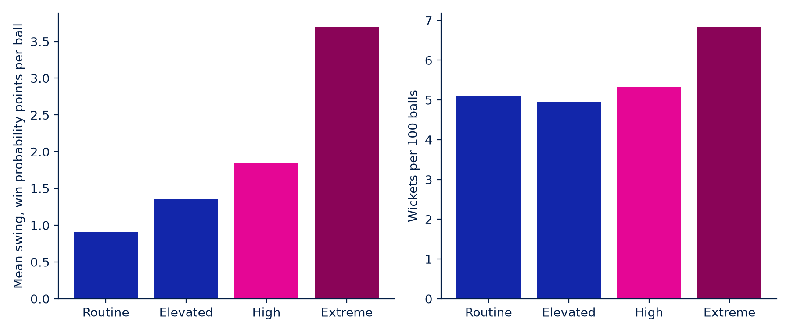
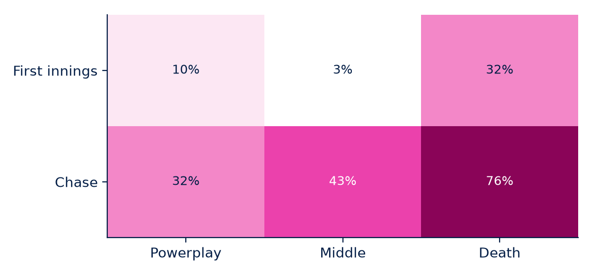
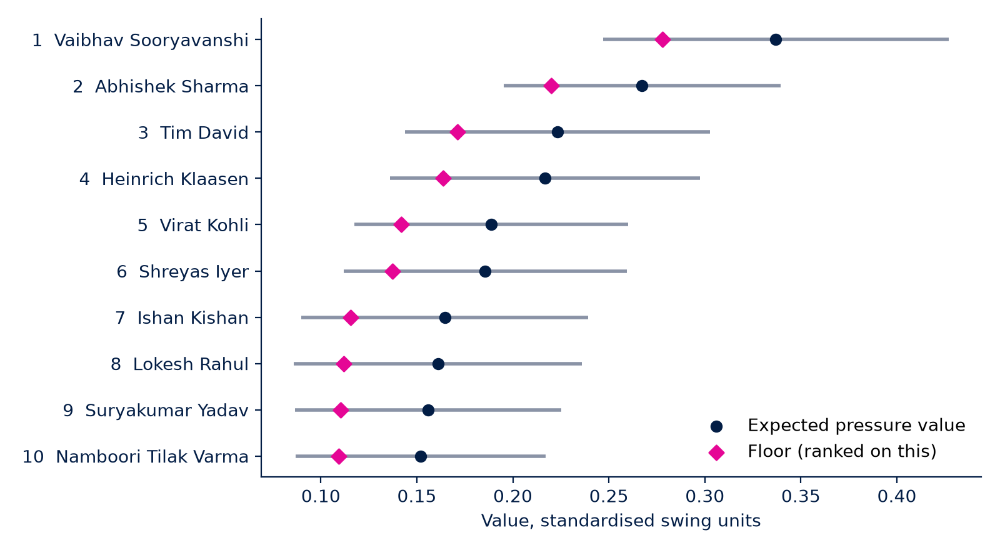
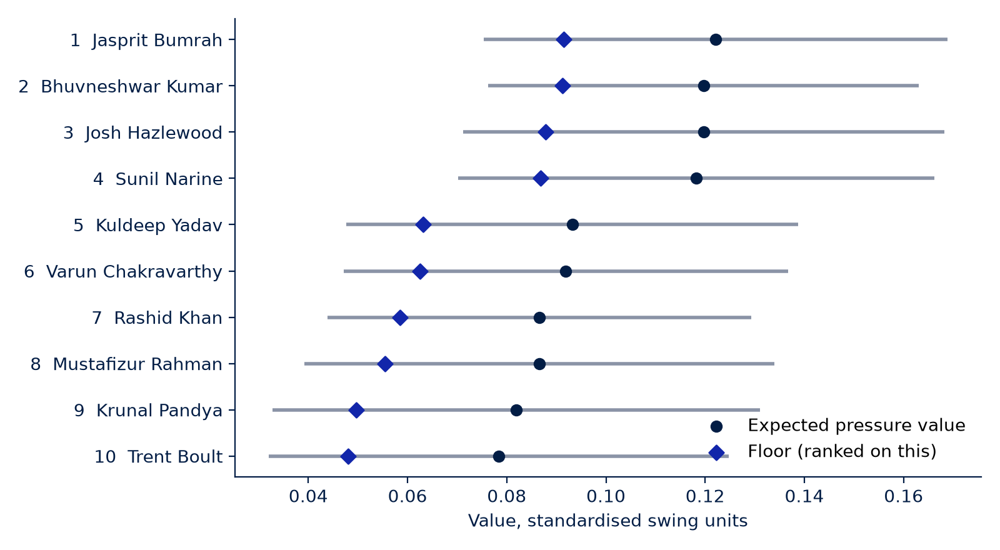
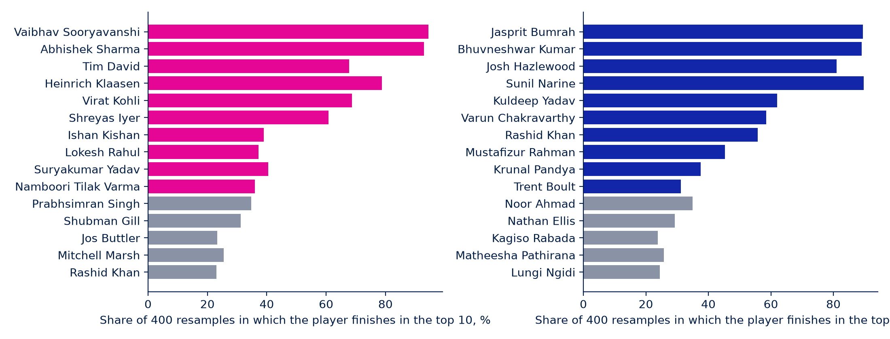

# Reliable Under Pressure: Rating Batters and Bowlers When the Match Is on the Line

**Team IdeaForge: Harsh Kawatra, Delhi Technological University (DTU), Team Leader.** Prepared for Rajasthan Royals and Unstop, SupeRR Selector Season 2, Round 1. Model hash c34d772dd7.

**Answer.** In our model the most reliable batters under pressure are Vaibhav Sooryavanshi, Abhishek Sharma and Tim David, and the most reliable bowlers are Jasprit Bumrah, Bhuvneshwar Kumar and Josh Hazlewood. A player's extra under pressure does not repeat from one half of his matches to the other (+0.16 for batters, −0.07 for bowlers), while everyday quality does. So we blend each pressure record with the everyday record behind it and rank on the level we are 80% sure the player exceeds, which we call the floor.

| Rank | Batter | Pressure balls | Floor (points per 100 pressure balls) | Top-10 probability |
|---|---|---|---|---|
| 1 | Vaibhav Sooryavanshi | 119 | +72 (floor +0.278) | 94% |
| 2 | Abhishek Sharma | 351 | +57 | 93% |
| 3 | Tim David | 444 | +44 | 68% |
| 4 | Heinrich Klaasen | 319 | +42 | 79% |
| 5 | Virat Kohli | 597 | +37 | 69% |
| 6 | Shreyas Iyer | 409 | +36 | 61% |
| 7 | Ishan Kishan | 438 | +30 | 39% |
| 8 | Lokesh Rahul | 429 | +29 | 37% |
| 9 | Suryakumar Yadav | 527 | +29 | 40% |
| 10 | Namboori Tilak Varma | 698 | +28 | 36% |

| Rank | Bowler | Pressure balls | Floor (points per 100 pressure balls) | Top-10 probability |
|---|---|---|---|---|
| 1 | Jasprit Bumrah | 455 | +24 | 90% |
| 2 | Bhuvneshwar Kumar | 709 | +24 | 89% |
| 3 | Josh Hazlewood | 421 | +23 | 81% |
| 4 | Sunil Narine | 400 | +22 | 90% |
| 5 | Kuldeep Yadav | 443 | +16 | 62% |
| 6 | Varun Chakravarthy | 516 | +16 | 58% |
| 7 | Rashid Khan | 662 | +15 | 56% |
| 8 | Mustafizur Rahman | 370 | +14 | 45% |
| 9 | Krunal Pandya | 360 | +13 | 38% |
| 10 | Trent Boult | 517 | +12 | 31% |

A value of 100 win-probability points is one match, so a floor of +29 points per 100 pressure balls is about 0.29 matches swung per 100 pressure balls. The top four batters and top four bowlers are firm. From about sixth place the ranks are soft, because the floors sit close together.

## 1. Pressure definition: the match situations and indicators we used, and why

**Answer.** We define pressure ball by ball from the match state, using one learned quantity for stakes and three simple signals for context. A ball is a pressure ball when its Pressure Index is 75 or higher, which is one live ball in four by construction.

We rebuilt the state before each of the 2,00,999 supplied balls: runs, wickets down, balls left, and in a chase the target and runs needed. A win-probability model gives the batting side's chance of winning before every ball. Balls where that chance is under 3% or over 97% are dead and are dropped (10.2% of balls), because nothing on them can change the result.

The brief lists required run rate, wickets in hand, balls remaining, the stage of an innings and how close the contest is. Our four signals cover each of them:

| Signal | What it measures | Brief signal it carries | Weight |
|---|---|---|---|
| Swing | Expected size of the win-probability movement from one ball, as a percentile | Required rate, balls left, wickets in hand, closeness, all through win probability | 0.50 |
| Balance | 1 minus the distance of win probability from 50% | How close the contest is | 0.20 |
| Clock | Share of the innings bowled, squared | Stage of the innings | 0.15 |
| Wicket stress | Wickets down against the league norm for that over, scaled to 0 to 1 | Wickets in hand | 0.15 |

The raw score is (0.50 swing + 0.20 balance + 0.15 clock + 0.15 wicket stress) multiplied by 1.15 in a knockout match. The Pressure Index is its percentile among live balls. The bands are Routine under 50, Elevated 50 to 75, High 75 to 90 and Extreme 90 and above. ESPNcricinfo Smart Stats also uses the name Pressure Index for a different measure; ours is a percentile of this four-signal composite.

**It separates pressure from ordinary play.** Mean swing per ball is 0.91 points in Routine, 1.36 in Elevated, 1.85 in High and 3.70 in Extreme, so an Extreme ball moves the result 4.1 times as far as a Routine one. Wickets fall on 5.1% of Routine balls and 6.8% of Extreme balls. Pressure is not spread evenly: 76% of chase death-over balls are pressure balls against 3% of first-innings middle overs, and 60% of knockout balls against 24% of league balls.

We did not use swing alone because first-innings win probability moves slowly, so swing alone would call almost no first-innings ball pressure. The clock and wicket-stress terms bring in batting first at the death and rebuilding after a collapse. Using swing alone changes the ranking little (rank correlation 0.98 for batters and 0.99 for bowlers).

## 2. Performance measurement: batting and bowling metrics, player baselines, and rating logic

**Answer.** Every ball is valued by how much it changed the chance of winning, compared with the league's average result in the same situation. A player's rating blends his pressure record with his ordinary record, weighted by how much each predicts, and players are ranked on the floor.

**Win probability.** A chase model uses the log of runs needed over expected remaining runs, the required rate against the scoring environment, and a last-overs term. A first-innings model uses projected score against par, innings progress and wickets. Expected remaining runs come from a resources curve in the published Duckworth-Lewis form, fitted by least squares to this data (the form is cited as given in teaching notes). Out of fold, grouped by match, the chase model has AUC 0.90 and log loss 0.393, and the first-innings model has AUC 0.69. It beat a boosted benchmark in both innings. Out of time (trained on 2022 to 2024, tested on 2025 to 2026) the chase AUC is 0.917.

**Credit rules.** The batter is credited with win-probability change from his own runs and his own dismissal. Wides give him nothing, byes and leg byes count as a dot, and a stumping off a wide is charged to him. The bowler is charged with batter runs plus wides and no-balls, and credited with wickets other than run outs, retirements and obstruction. A tactical retired-out is charged to nobody. Each credit is divided by the ball's swing, so a boundary in a tight finish and a boundary in the eighth over sit on one scale.

**Two baselines.** The first is the league mean in the same innings, phase, pressure band and bowling kind (pace or spin). Subtracting it gives a value of zero for an average result in that situation. The second is the player's own ordinary record (balls with Pressure Index under 75), which is what "compared with their usual level" means in the brief [C-1]. A ridge opposition adjustment then removes the strength of the bowler a batter faced, and the reverse for bowlers.

**Rating logic.** True pressure and ordinary levels are treated as drawn from a two-dimensional normal distribution estimated from the qualified pool. This bivariate prior is our own extension of standard shrinkage (Efron and Morris). The expected pressure value is the posterior mean of the pressure level given both records. The floor is that mean minus 0.84 posterior standard deviations. A short or volatile record has a wide interval and a lower floor.

**Recency.** A ball's weight halves every 365 days for batters and every 1,095 days for bowlers. Our own out-of-time test chose these half-lives: batting form is recent and bowling quality is durable. A six hit in 2022 therefore counts far less than one hit in 2026.

**Worked example.** Sooryavanshi has 119 pressure balls, a pressure value of +0.68 and an ordinary value of +0.39. Both records are high, the pressure record is short, and the floor is +0.278, which is +72 points per 100 pressure balls, or 0.72 matches swung per 100 pressure balls. Bumrah has 455 pressure balls, +0.27 under pressure and +0.18 ordinary, giving a floor of +0.091, or +24 points per 100 balls.

## 3. Fair comparisons: sample sizes, eligibility, match contexts, and the use of IPL and T20I data

**Answer.** Players are compared only against the league in the same situation, only with enough balls, and only if they can actually be bought at the 2027 auction.

**Sample sizes.** A player needs at least 110 pressure balls and 110 ordinary balls in the role. We first set this at 120 and moved it to 110 during our audit. At 100 or 110 the top 10 is identical. At 120, Sooryavanshi (119 balls) drops out and Shubman Gill enters, so the gate is a stated judgement and we show both lists. The floor also penalises thin records directly, because a short record carries a wide interval.

**Eligibility.** The pool is players active since 1 June 2025 who can register for the IPL (players of the Pakistan side are excluded, which keeps Haris Rauf, who would rank about ninth among bowlers, out). Players who cannot be bought at the 2027 auction are barred with their record kept visible. Andre Russell (rank 7 before the bar) retired from the IPL as a player. Harry Brook (rank 3 before the bar) is barred on a two-season ban, though sources conflict on its length (six say no auction before 2028, three say it ended with 2026). MS Dhoni retired on 17 November 2026 and was already outside the lists. Players whose pressure record is significantly worse than their ordinary one are labelled Dips and cannot take a top-10 place: Phil Salt, Glenn Phillips and Rajat Patidar among batters; Mohsin Khan, Blessing Muzarabani, Jacob Duffy, Arshdeep Singh and Corbin Bosch among bowlers. The funnel for batters runs 788, 226, 114, 100, 97, 87, and for bowlers 577, 221, 120, 107, 101, 83.

**Match contexts.** The scoring environment differs by tier and season (first-innings runs per ball range from 1.42 in 2022 T20Is to 1.65 in IPL 2026), so a par score is set per environment. The baselines separate innings, phase, band and pace from spin, and the opposition adjustment handles strength of opponent. Knockout matches carry the 15% uplift.

**IPL and T20I.** IPL balls carry weight 1.00, T20Is between full members 0.85, and T20Is involving an associate side 0.60. Restricting to IPL balls only is the least stable variant we tested, with rank correlation 0.80 to 0.95, so the T20I data helps, and a model that used only IPL balls would keep fewer of the same names.

## 4. Evidence for the top 10: the results, comparisons, tables and charts that support the selections and ordering

**Answer.** The two ranked tables above are the evidence. They show a floor, a pressure record, an ordinary record and a resampling probability for each name.

Pressure and ordinary values (recency weighted, standardised swing units) for the batters are: Sooryavanshi +0.68 and +0.39, Abhishek Sharma +0.28 and +0.26, David +0.27 and +0.29, Klaasen +0.35 and +0.18, Kohli +0.24 and +0.16, Iyer +0.24 and +0.16, Kishan +0.15 and +0.16, Rahul +0.24 and +0.11, Suryakumar +0.18 and +0.12, Tilak Varma +0.20 and +0.09. For the bowlers: Bumrah +0.27 and +0.18, Bhuvneshwar +0.22 and +0.17, Hazlewood +0.30 and +0.17, Narine +0.25 and +0.20, Kuldeep +0.20 and +0.13, Chakravarthy +0.10 and +0.19, Rashid +0.15 and +0.13, Mustafizur +0.14 and +0.16, Krunal Pandya +0.19 and +0.12, Boult +0.21 and +0.06.

**Ordering.** Rank 1 and 2 batters are separated by about 0.058 of floor, inside their rank ranges (1 to 6 and 1 to 8), so the order of the top two is soft even though both are firm in the top 10. Bumrah and Bhuvneshwar share a floor of +0.091 and sit 1 and 2 by the third decimal. Sooryavanshi and Boult are labelled Rises (Boult's pressure value is +0.21 against +0.06 ordinary) and every other name is Steady, so no top-10 player is carried by a pressure-only record and none is labelled Dips.

**Suryakumar Yadav.** Without recency weighting he ranked 2nd on strength of 2022 and 2023. The data runs to 1 November 2026, and his last T20I in it is 31 January 2026, after which India played 24 T20Is without him under Shreyas Iyer. With recency weighting he ranks 9th with a 40% top-10 probability, held up by IPL 2025 (101 pressure balls, strike rate 183). We include him on that record and flag the softness.

**Royals context.** Under pressure in 2026 the Royals batted 2nd of 10 IPL sides and bowled 7th, worst at the death (9th) and 6th in the middle overs. Sooryavanshi is already a Royals batter. No Royals bowler reaches the top 10, so the gap is bowling in the middle and death overs.

## 5. Reliability and limitations: how we checked consistency across matches, and where the model may be less certain

**Answer.** We tested the ranking with resampling, split halves, an out-of-time test and nine variants. It holds at the top and is soft from sixth place, and batting pressure value is not predictable in this data.

**Resampling.** We resampled whole matches 400 times and re-ranked each time. The probability of finishing in the top 10 is in the tables above, and the rank range is the 10th to 90th percentile of rank. Five batters and four bowlers finish in the top 10 in at least 65% of resamples.

**Consistency across matches.** For each top-10 player we counted pressure matches (4 or more pressure balls), the share in which he helped his side, and the matches that swung 15 or more win-probability points for and against. These are evidence and are not used to rank.

**Split halves.** Splitting matches into odd and even and correlating the halves across players, pressure value repeats for batters at +0.37 and for bowlers at +0.07, ordinary value at +0.20 and +0.18, and lift (pressure minus ordinary) at +0.16 and −0.07. We write that there is no evidence in this window that lift repeats, not that clutch skill does not exist. This is why the rating leans on the everyday record.

**Out of time.** Using ratings from 2022 to 2024 against pressure value in 2025 to 2026, the bowlers' top 10 by our floor delivered +0.205 per pressure ball later, against +0.117 for the top 10 by raw pressure numbers and +0.066 for the pool. Batters: +0.117 for our floor, +0.111 for raw pressure numbers and +0.125 for the pool. For bowlers our rating predicts later pressure value and clearly beats raw numbers. For batters nothing predicts later pressure value, ours included, so the batting list describes the record to date: firm in its top four and soft after.

**Stability.** Across nine variants (swing only, equal weights, no knockout uplift, thresholds of 67, 80 and 90, IPL balls only, no opposition adjustment, no tier weights), rank correlations run from 0.80 to 1.00, and the lowest is IPL balls only.

**Where the model is less certain.**
- Ranks 6 to 10 in both lists are soft, since top-10 probabilities there are 31% to 62%.
- Sooryavanshi sits at 119 pressure balls, close to the 110 gate.
- For bowlers, pressure value adds little beyond ordinary value (prior correlation 0.81 against 0.95 for batters), so a bowler's pressure record is read mostly through his everyday record.
- There is no fielding, wicket-keeping, venue, dew or partnership data.
- Win probability carries its own error: the largest calibration gap in a well-filled bin is 0.025.
- Facts outside the data are time-bound. Brook's ban length is disputed. Mustafizur Rahman's BCCI clearance, and a report that Hazlewood may skip IPL 2027, are unconfirmed. Official retention lists were incomplete on 17 November 2026.

**Audit before submission.** We found and fixed five defects: a filter that dropped all Chennai and Lucknow wins (65 matches), shortened matches valued as 20 overs, a step in the model at 12 balls left plus non-monotone cells, mishandled stumpings off wides and tactical retired-outs, and a 5-point IPL calibration bias. Lists changed after the fixes, and the lists above are the post-audit lists.

*Derived from Rajasthan Royals data supplied for SupeRR Selector Season 2. No ball-level data is published. Dashboard: https://github.com/harshkawatra11/rr-player-ml*
